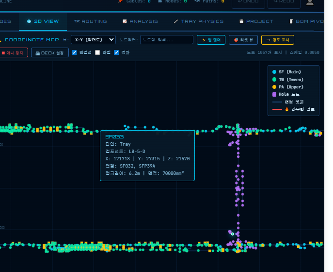
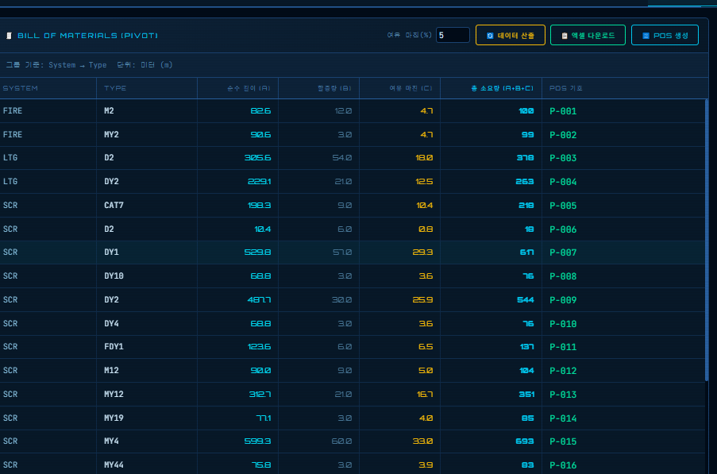
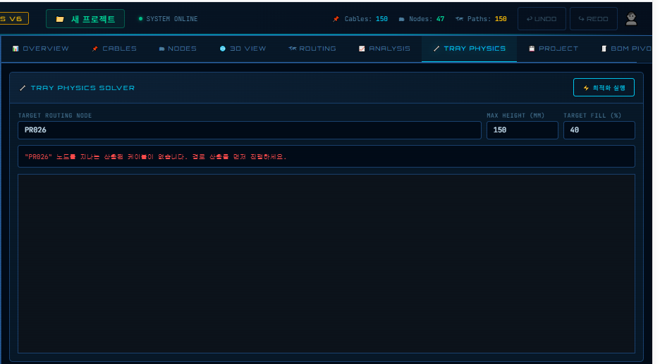
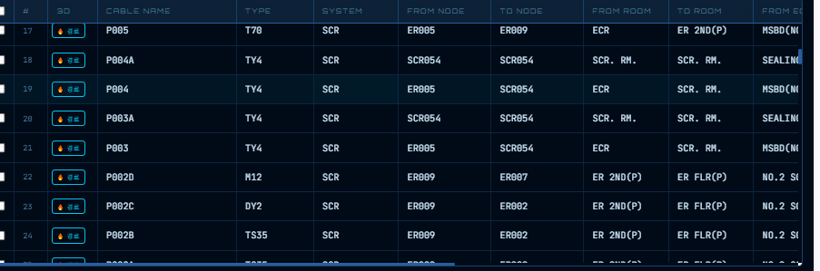

구글계정 로그인불가

로그인 관리자로 로그인 보튼추가
관리자 비번은 하드코딩하지 않을것임
문자인증아니 네이버 카카오 인증중 하나로 관리자 인증가능하게해
김봉정으로 인증받아야 관리자로 로그인가능하게 할거야

3d맵은 여전히 35k fd의 노드기록으로 하드코딩되어있음
이건 지우로 새롭게 업로드 되는 노드로 맵을 그리게 하고 케이블 테이터 역시 새롭게 로드한것으로 저장까지 되고 프로젝트까지 되개해줘

일반사용자는 구글로 인증후 관라자에고 사용요청을 보내면 관리자는 승인해주고 호선생성 기능을 부여하고 그룹을 지정하게 할수있음. 그룹별로 같은 프로젝트 공유가능하게해

 pos생성시 pos번호는 사용자에게 입력을 받고 아래와 같이 htmㅣ로 문서생성후 doc로 변환기능 구현해

tray physics기능은 첨부의 fill파일을 분석해서 완벽하게 적용해줘
가 노드별 리스트를 만들고 각 노드별 적정 tray size를 fill을 이용해서 만들어줘
전체 width만을 나타내주고 전체 마진은 사용자가 적용하게해줘 일괄적용하게해
fill기능은 전체 노드리스트를 만든뒤 fill확인버튼을 누르면 케이블리스트와 그림을 자동으로 폭산출해서 만들고 fill파일의 기능을 100% 가져와와 완벽하게 호환되개해줘 

nodes메누는  케이블 리스트는 리스트보기를누르면 전체 해당 노드를 지나는 케이블노드를 보여주고 엑셀로 내보내기 하면 모든 노드를 엑셀로 시트로 만들어서 각 노드별 케이블 리스트를 생성하게 해줘

 케이블 리스트 메뉴에서 옆으로 이동하면 상단의 타이틀은 이동이 되지 않고 내용만 움직여서 일치화되는데 문제가있어 
CABLE_SYSTEM	WD_PAGE	CABLE_NAME	CABLE_TYPE	FROM_ROOM	FROM_EQUIP	FROM_NODE	FROM_REST	TO_ROOM	TO_EQUIP	TO_NODE	TO_REST	POR_LENGTH	CABLE_PATH	CABLE_OUTDIA	CHECK_NODE	SUPPLY_DECK	POR_WEIGHT	INTERFERENCE	REMARK
엑셀리스트에 보여지는 항목은 반드시 위 타이틀이 모두 반영되게해 읽어오는 양식도 해당 양식으로 반드시 작성되게해고 케이블 리스트 작성예시버튼을 만들어서 아래 항목의 예시파일을 다운받을수 있게해줘
TO_NODE	TO_REST	POR_LENGTH	CABLE_PATH	CABLE_OUTDIA	CHECK_NODE	SUPPLY_DECK	POR_WEIGHT	INTERFERENCE	REMARK	REMARK1	REMARK2	REMARK3	REVISION
TW185C	4			13.2	TW200	TW	39520	MY4_F	 WIR. DIA. 변경			P874	1

노드파일역시 아래 예시의 양식으로 작성되게하고 엑셀파일로 예시 파일을 다운로드 받을수있게해줘
NODE_RNAME	STRUCTURE_NAME	COMPONENT	NODE_TYPE	CABLE_LIST	RELATION	LINK_LENGTH	AREA_SIZE	MAX_CABLE	POINT
BC051		C-4	Tray		TOS38A	2	46060	100	S : 121725,-27448.9,26589.2 E : 121740,-27489.9,24602.1
BC099			Tray			0.6	10000	100	S : 121418,-28202.5,26622 E : 121969,-28202.5,26630
PA001		RLB-5-D	Tray		PA002,TWS59D	4.4	70000	100	S : 189360,-30520,11192 E : 189360,-30545,15552
PA002		RLB-5-D	Tray		PA001,PAS59A	5.6	70000	100	S : 189360,-30520,11192 E : 189782,-30545,6060
PA003		C-5	Tray		PA004,TWS59C	0.5	56000	100	S : 189560,-26360,15199.8 E : 189560,-26400,15558.9
PA004		C-5	Tray		PA003,PA005	6.3	56000	100	S : 189560,-26360,15199.8 E : 189560,-26360,8949.89

위 양식이 맞지 않는다면 반드시 양식에 맞게 작성해라고 경고를 제시해

그리고 노드 연결이 안돼서 경로 생성이 안되는건 에러를 발생시켜서 어떠한 문제